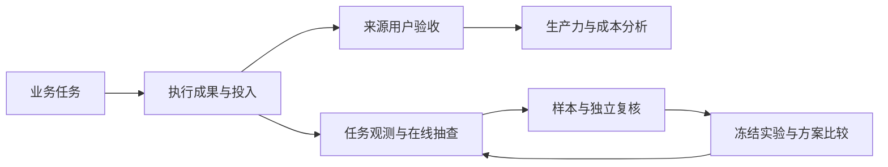

# Outcome

**以任务成果为核心的数字员工生产力与质量治理设计规范。**

Outcome 连接业务验收、执行投入、任务观测与质量评测，帮助企业回答三个问题：数字员工交付了什么、节省了多少成本与人工投入、改进是否经过验证。

本项目包含设计规范和可交互的本地参考原型，适用于产品设计、企业集成规划及实现方案评审。

## 工作方式



业务用户在来源系统验收成果；Outcome 汇聚任务事实与证据，衡量价值并组织持续改进。运行成功或自动评分不替代业务验收。

## 核心能力

| 能力 | 解决的问题 |
| --- | --- |
| 任务与成果台账 | 关联任务意图、执行尝试、成果版本和用户验收，保留失败与返工事实 |
| 生产力与成本分析 | 设定同质量基准成本与人工工时，对比实际投入，展示节省金额与有效样本覆盖 |
| 任务观测与在线评测 | 发现异常、分派处置、抽样核验并回流问题样本 |
| 评测集与独立复核 | 维护样本和质量标准，将标注、独立复核与发布版本分离 |
| 实验与对比 | 使用冻结数据和评估器验证方案；输入或标准不一致时仅展示描述性比较 |
| 企业集成与 RBAC | 通过事件契约连接既有业务和 Agent 系统，以角色配置资源权限并约束数据范围 |

成本缺失不补零；零基准不计算节省率。报告保留发布时的基准与任务证据，避免后续配置变化改写历史结论。

## 快速体验

克隆仓库后，在浏览器打开 `index.html`，无需安装依赖或连接模型服务。

```sh
git clone https://github.com/zqshi/outcome.git
cd outcome
open index.html
```

建议从**任务台账 → 生产力分析 → 任务观测 → 评测集 → 独立质量复核 → 实验与对比**了解完整流程。原型数据保存在当前浏览器本地存储中。

## 项目组成

| 文件 | 内容 |
| --- | --- |
| [SPEC.md](SPEC.md) | 领域模型、事件契约、指标公式、权限与符合性要求 |
| [ROADMAP.md](ROADMAP.md) | 实现阶段、验收门槛与产品演进方向 |
| [index.html](index.html) | 自包含的交互参考原型 |
| [prototype/README.md](prototype/README.md) | 原型运行、组件规则与验证方式 |
| [scripts/](scripts/) | 领域逻辑与集成交互验证脚本 |

规范定义应实现的行为，原型展示流程与交互。根目录的 `quality-*-module.js` 是独立模块样例，原型运行不依赖这些文件。

## 验证

安装 Node.js 后，可运行核心验证：

```sh
node scripts/verify-integrated.cjs
node scripts/verify-ux-integrated.cjs
```

更多验证入口见[原型说明](prototype/README.md)。逻辑验证不替代真实浏览器验收或生产符合性检查。

## 项目状态

**规范 v0.1 · 设计草案与参考原型。**

身份切换、企业接入和评测执行包含模拟行为，当前不提供生产认证、服务端授权、网络连接器或后台执行服务。生产实现需依据规范构建持久化、真实集成、审计与恢复能力，并完成符合性检查。
